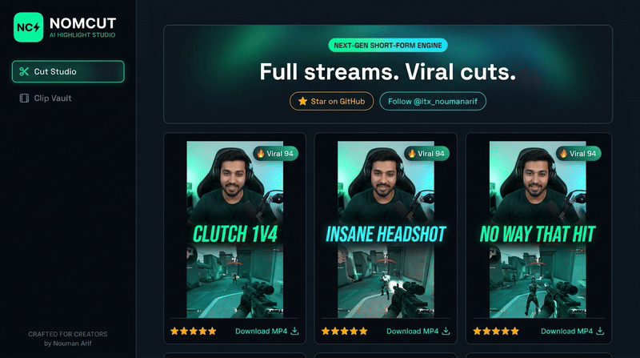
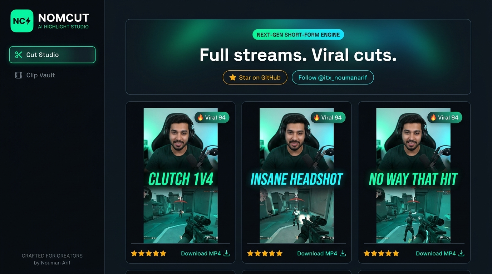
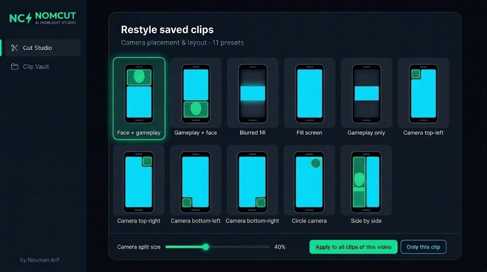

# NomCut ⚡

**Full streams. Viral cuts. Generate captioned 9:16 vertical shorts in under two minutes — free, local, and open-source.**

NomCut transforms long-form YouTube, Twitch, and Kick broadcasts (or local MP4 recordings) into publish-ready vertical clips complete with dynamic word-by-word subtitles, punchy opening hooks, and smart facecam framing. Everything executes privately on your hardware with zero cloud fees, zero watermarks, and no account required.

[](https://github.com/StingLikeABeee/NomCut) [](https://www.instagram.com/itx_noumanarif/)

**Created by [Nouman Arif](https://www.instagram.com/itx_noumanarif/)**. If NomCut speeds up your content workflow, please ⭐ star this repository on GitHub and follow [@itx_noumanarif](https://www.instagram.com/itx_noumanarif/) on Instagram!





🤖 **Want an AI coding agent to install it for you?** Copy [docs/NOMCUT-AGENT-SETUP-PROMPT.txt](docs/NOMCUT-AGENT-SETUP-PROMPT.txt) into Claude Code, Codex CLI, Antigravity, or Cursor.

---

## ⚡ How the Highlight Engine Works

Two scanning pipelines, triggered with a single click:

### 1. Turbo Mode (Default for videos > 10 min)
Designed for speed by never downloading the full multi-gigabyte video upfront:

1. **Audio-First Fetch:** Downloads only the lightweight audio stream (~79 MB for an 85-minute broadcast in ~10 seconds).
2. **Instant Transcript Extraction:** Pulls word-timed captions directly from YouTube's native `json3` tracks in about a second (falling back to local Whisper ASR for uncaptioned sources).
3. **Multi-Band Audio Analysis:** Scans the entire timeline for sudden decibel jumps against a rolling 2-minute baseline, vocal excitement in the 2–4 kHz band, and quiet-to-loud bursts.
4. **Local LLM Curation:** Passes the highest-scoring candidate transcripts to your local Ollama model to evaluate narrative payoff, generate a title, draft an opening hook, and snap cut points cleanly to sentence boundaries within your Min/Max duration.
5. **Surgical Section Download & Render:** Fetches **only the winning timestamp ranges**, aligns keyframes via FFT audio cross-correlation, and encodes 1080×1920 vertical MP4s with burned-in subtitles.

### 2. Deep Scan Mode
Downloads the complete source video and runs parallel OpenCV Farneback optical-flow analysis (detecting high-velocity motion, impacts, flashes, and camera cuts) alongside audio and transcript signals, evaluating 4× more candidate windows with surrounding context.

---

## 🎯 Multi-Signal Viral Scoring & Adaptive Learning

Every candidate moment is evaluated across five core signals:

| Signal | What It Detects |
|---|---|
| **Loudness Surge** | Sudden audio booms or reactions relative to the surrounding 2-minute baseline |
| **Vocal Energy** | High-frequency vocal intensity (2–4 kHz screaming, laughing, shouting) |
| **Spoken Hype Lexicon** | High-arousal phrases in English, Hinglish, and Hindi (*"oh my god"*, *"no way"*, *"bhaago"*, *"arre yaar"*) |
| **Visual Action** | Fast optical-flow movement, explosion flashes, strobe flicker, and rapid scene cuts |
| **Semantic AI Score** | Local LLM evaluation of setup, humor, insight, and payoff |

**Adaptive Taste Engine:** Every generated clip includes a 5-star rating bar stored locally in `data/feedback.jsonl`. Once you rate 8+ clips, NomCut automatically refits its signal weights using regularized ridge regression — adapting to whether you prefer high-energy gaming chaos or calm, story-driven commentary.

---

## ✨ Key Studio Features

- **Single-Click Auto-Cut (`⚡ Auto-cut clips`):** Live progress tracking with vertical shorts streaming into your workspace as they finish rendering.
- **11 Native Creator Layouts:** Stack camera above or below gameplay, ambient blurred fill, full-screen center crop, gameplay-only, 4 floating PiP corners, circular facecam mask, and side-by-side split — plus aspect ratio support for `9:16`, `1:1`, `4:5`, `3:4`, and `16:9` up to 4K (`2160p`).
- **Automatic Facecam Finder (`🔎 Find my facecam`):** Samples 14 frames across the video, locates static border geometry, and verifies human presence using an embedded YuNet face detector (`models/face_detection_yunet_2023mar.onnx`), ignoring game minimaps and HUD overlays.
- **5 Dynamic Caption Presets + 6 Animations:** Choose from **Cyber Pulse**, **Impact**, **Hormozi**, **MrBeast**, or **Minimal** with word-by-word highlight, pop-in, line pop, one-by-one, build-up, or full-line animations.
- **Custom Brand Profiles & Subtitle Editor:** Customize font family, size, active/rest/outline colors, and words-per-line. Edit word timings directly in the browser, shift cues, or import/export `.srt`, `.ass`, and `.vtt` tracks.
- **Automatic Hinglish Transliteration:** Converts Devanagari Hindi speech into natural Roman Hinglish (*"kya haal hai bhai"*) automatically while preserving exact word timestamps.
- **Social Cards, Watermarks & Audio Risers:** Frame cuts inside **X Post (Light/Dark)**, **TikTok Hook**, or **Breaking News** templates. Add rounded padded backdrops, corner logos, channel credit badges, animated outro banners, and background music beds that swell during the final seconds.
- **Instant Restyling (`Restyle saved clips`):** Update the layout, camera size, caption preset, or overlays on one clip — or across every clip generated from the same video — without re-downloading or re-transcribing.



---

## 📡 Real-Time Stream Clipper, Streamer Watchlist & Phone Remote

- **Real-Time Stream Clipper:** Paste an active Twitch or YouTube Live URL. NomCut buffers the stream via Streamlink, monitors anonymous live chat in 10-second buckets, and automatically cuts a backdated vertical clip (~24 s before the peak) whenever chat velocity spikes above 2.5σ and 2.5× the 5-minute baseline.
- **Streamer Watchlist (`👥 Creators`):** Add your favorite Twitch or YouTube channels once. NomCut checks every 60 seconds and automatically begins recording and clipping chat spikes the moment a tracked creator goes live.
- **Wi-Fi Phone Remote (`/m`):** Launch NomCut with `Start-NomCut-Phone.bat` (or set `NOMCUT_LAN=1`). Connect from your phone on the same Wi-Fi using the 6-digit PIN displayed in the studio to watch the live chat hype meter, trigger instant cuts (`Clip now`), and save MP4s directly to your phone.

---

## 🚀 Installation & Quick Start

### Option 1: One-Click Windows Installer
Download [`NomCut-Setup.bat`](https://github.com/StingLikeABeee/NomCut/releases/latest/download/NomCut-Setup.bat) and double-click it. It verifies your system, installs Python 3.12 and portable FFmpeg if missing, sets up NomCut in `%LOCALAPPDATA%\NomCut`, creates Desktop shortcuts, and launches the studio.

### Option 2: Manual / Developer Setup
**Prerequisites:** Python 3.10+ and FFmpeg on your system `PATH`.  
*Recommended:* [Ollama](https://ollama.com) with `ollama pull llama3.2:3b` for AI titles, hooks, and semantic scoring, plus an NVIDIA GPU for NVENC hardware encoding.

```bash
git clone https://github.com/StingLikeABeee/NomCut
cd NomCut

# Windows (PowerShell)
./run.ps1

# macOS / Linux
./run.sh
```

Then open **<http://127.0.0.1:8770>** in your browser, paste a video link, and click **⚡ Auto-cut clips**.

Optional CUDA speech acceleration (for videos without YouTube captions):
```bash
.venv/bin/pip install nvidia-cublas-cu12 "nvidia-cudnn-cu12==9.*"
```
Environment variables:
- `NOMCUT_PORT=9000` — run on a custom port (default `8770`).
- `NOMCUT_CPU=1` — force CPU execution for local Whisper transcription.
- `NOMCUT_LAN=1` — enable the PIN-protected Wi-Fi phone remote (`/m`).
- `NOMCUT_DATA_DIR=/path/to/data` — custom storage directory for downloads and renders.

---

## 🗂️ Project Architecture

| Module | Responsibility |
|---|---|
| `app.py` | FastAPI server, `/make` auto-cut pipeline, FFmpeg export engine, Clip Vault |
| `smart.py` | Candidate scoring, local Ollama LLM evaluation, sentence-boundary snapping |
| `highlights.py` | Parallel optical-flow motion, audio decibel surge, and vocal frequency ranking |
| `captions_yt.py` | High-speed YouTube `json3` word-timed caption extractor |
| `captions.py` | Local `faster-whisper` ASR (GPU/CPU), word grouping, ASS/SRT/VTT styling |
| `translit.py` | Rule-based + dictionary Devanagari → Roman Hinglish transliterator |
| `facecam_detect.py` | Static border detector paired with YuNet ONNX face verification |
| `live_session.py` & `creators.py` | Streamlink live recording, Twitch/YouTube chat spike detector, auto-watchlist |
| `styling.py` & `layouts.py` | 11 native layouts, social post templates, watermarks, music riser beds |
| `reedit.py` & `bundles.py` | Zero-retranscription saved clip restyling and ZIP bundle export |
| `phone.py` & `mobile.html` | PIN-authenticated LAN mobile remote for live stream monitoring |

---

## 🧪 Running Tests

Run the portable unit test suite (requires no network or GPU):

```bash
python -m unittest discover -s tests -v
```

---

## 🤝 Connect & Support

NomCut is 100% free and open-source. If it helps you create better content faster:
- ⭐ **Star the repo on GitHub:** [github.com/StingLikeABeee/NomCut](https://github.com/StingLikeABeee/NomCut)
- 📸 **Follow Nouman Arif on Instagram:** [@itx_noumanarif](https://www.instagram.com/itx_noumanarif/)

## 📄 License

Released under the [MIT License](LICENSE). Copyright (c) 2026 Nouman Arif.
